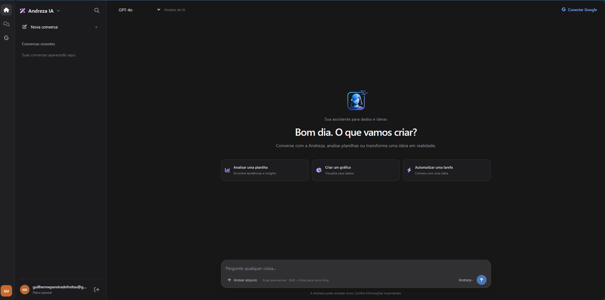
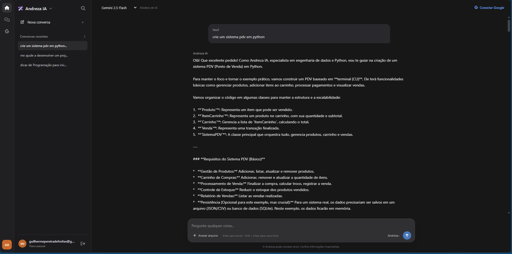

<p align="center">
  
</p>

<h1 align="center">Andreza IA</h1>

<p align="center">
  Assistente de inteligência artificial para análise de dados, planilhas e automação.
</p>

<p align="center">
  
  
  
</p>

## Sobre o projeto

A Andreza IA é uma aplicação web desenvolvida em Python e Flask, com uma interface escura inspirada em assistentes de IA. Ela combina modelos de linguagem com ferramentas para análise de arquivos, visualização de dados, histórico de conversas, memória semântica e integração opcional com o Google Sheets.

## Amostras do sistema

<p align="center">
  
</p>
<p align="center"><em>Tela de login</em></p>

<p align="center">
  
</p>
<p align="center"><em>Interface de conversa</em></p>

<p align="center">
  
</p>
<p align="center"><em>Exemplo de pesquisa e resposta</em></p>

## Funcionalidades

- **Conversas:** criar conversas, consultar o histórico, pesquisar conversas e excluir chats.
- **Modelos de IA:** selecionar GPT-4o (OpenAI) ou Gemini 2.5 Flash (Google) pela interface.
- **Análise de arquivos:** enviar arquivos CSV e Excel (`.xlsx` e `.xls`) para análise com Pandas.
- **Gráficos:** gerar gráficos PNG quando a solicitação de análise pede uma visualização compatível.
- **Memória semântica (RAG):** armazenar trechos de conversas e recuperar contexto relevante com embeddings OpenAI e pgvector.
- **Google Sheets:** conectar uma conta Google individual via OAuth 2.0 e acrescentar valores a uma planilha autorizada.
- **Contas de usuário:** cadastro, login e senhas armazenadas com hash via Flask-Bcrypt.
- **Experiência de uso:** interface responsiva em português, sugestões de prompts, anexos e cópia de respostas.

## Tecnologias

- Python, Flask, Flask-Login e Flask-Bcrypt
- PostgreSQL e extensão pgvector
- OpenAI API e Google GenAI API
- Pandas, Matplotlib, Seaborn e OpenPyXL
- Google Sheets API e OAuth 2.0

## Pré-requisitos

- Python 3.11 ou superior
- PostgreSQL em execução
- Extensão [pgvector](https://github.com/pgvector/pgvector) instalada no servidor PostgreSQL
- Chaves de API dos provedores que serão utilizados
- (Opcional) Projeto Google Cloud configurado para OAuth e Google Sheets API

## Instalação

### 1. Criar e ativar um ambiente virtual

Na raiz do projeto, execute:

```powershell
python -m venv .venv
.\.venv\Scripts\Activate.ps1
```

No macOS ou Linux:

```bash
python3 -m venv .venv
source .venv/bin/activate
```

### 2. Instalar as dependências

```bash
python -m pip install -r requirements.txt
```

### 3. Criar o banco de dados

No PostgreSQL, crie o banco utilizado pela aplicação. Exemplo pelo `psql`:

```sql
CREATE DATABASE assistente_db;
```

Confirme que o pgvector está instalado no servidor. O comando `python database.py`, na próxima etapa, habilita a extensão no banco e cria as tabelas da aplicação.

### 4. Configurar variáveis de ambiente

Crie um arquivo `.env` na raiz do projeto. Preencha os valores localmente; não compartilhe nem envie esse arquivo ao Git:

```dotenv
DB_HOST=localhost
DB_PORT=5432
DB_NAME=assistente_db
DB_USER=postgres
DB_PASSWORD=sua_senha_do_postgres

SECRET_KEY=gere_uma_chave_secreta_forte
OPENAI_API_KEY=sua_chave_openai
GEMINI_API_KEY=sua_chave_google_gemini
```

`OPENAI_API_KEY` é usada pelo GPT-4o e pela geração de embeddings da memória RAG. `GEMINI_API_KEY` é necessária quando o modelo Gemini for selecionado. Use uma chave forte e privada em `SECRET_KEY`.

### 5. Inicializar as tabelas

Com o ambiente virtual ativo e o PostgreSQL configurado:

```bash
python database.py
```

### 6. (Opcional) Configurar o Google Sheets

1. No [Google Cloud Console](https://console.cloud.google.com/), crie ou selecione um projeto.
2. Ative a Google Sheets API e configure a tela de consentimento OAuth.
3. Crie um cliente OAuth 2.0 do tipo **Aplicativo da Web** e adicione `http://localhost:5000/google/callback` como URI de redirecionamento autorizado.
4. Baixe o JSON de credenciais, salve-o como `credentials.json` na raiz do projeto e mantenha-o privado.
5. Inicie a aplicação, entre na sua conta e clique em **Conectar Google**.

O OAuth solicita permissões de planilhas e leitura do Drive. O endpoint disponível na aplicação acrescenta linhas à planilha indicada.

### 7. Iniciar a aplicação

```bash
python app.py
```

Acesse [http://localhost:5000](http://localhost:5000), crie uma conta e entre na aplicação.

## Como usar

1. Entre ou crie uma conta.
2. Inicie uma conversa ou selecione uma conversa existente no histórico.
3. Escolha GPT-4o ou Gemini 2.5 Flash no seletor de modelos.
4. Para analisar uma planilha, anexe um arquivo CSV ou Excel e escreva sua pergunta.
5. Peça um gráfico na mensagem para visualizar os dados quando houver colunas numéricas compatíveis.
6. Conecte sua conta Google para autorizar o uso da integração com planilhas.

## Estrutura do projeto

```text
.
├── app.py                   # Aplicação Flask, autenticação e rotas
├── database.py              # Conexão e inicialização do PostgreSQL
├── google_sheets.py         # OAuth por usuário e integração com Sheets
├── llm_service.py           # Chamadas aos modelos e criação de gráficos
├── rag_service.py           # Embeddings e memória semântica
├── requirements.txt         # Dependências Python
├── static/
│   ├── css/style.css        # Estilos da aplicação
│   ├── img/                 # Marca e capturas de tela
│   └── charts/              # Gráficos gerados
├── templates/
│   ├── index.html           # Interface principal
│   ├── login.html           # Tela de login
│   └── register.html        # Tela de cadastro
└── uploads/                 # Arquivos enviados para análise
```

## Observações

- O Gemini pode ficar temporariamente indisponível. Para respostas 503, a aplicação tenta novamente e informa quando é necessário aguardar ou trocar de modelo.
- A análise de arquivos é feita durante o processamento da mensagem. Evite enviar documentos com dados sensíveis que não devam ser compartilhados com os provedores de IA configurados.
- As chaves de API, `credentials.json` e o arquivo `.env` devem permanecer privados.

---

<p align="center">Andreza IA&reg; &#8226; Desenvolvida por Guilherme Pereira &#8226; Todos os direitos reservados</p>
